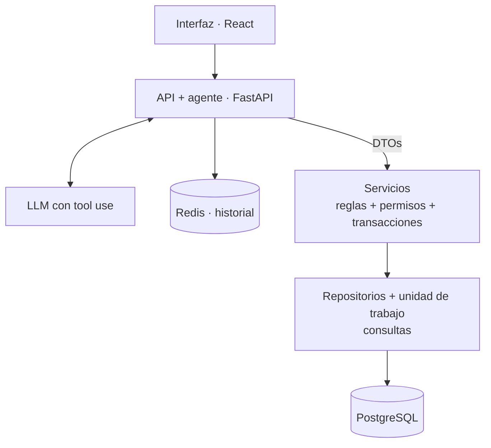

# ShopAgent

Agente de atención al cliente para **Loba Toys**, una tienda online ficticia de juguetes para perros, que no solo responde: **ejecuta acciones reales** (consultar, cancelar pedidos, cambiar direcciones, abrir tickets) mediante *tool use*, con las reglas de negocio blindadas en el backend.

🚧 En desarrollo · fase 3 de 4 · entrega 17-nov

## Lo diferencial

1. **El LLM nunca toca la base de datos.** Solo propone qué herramienta usar y con qué argumentos; la capa de servicios valida y ejecuta.
2. **Las reglas de negocio y los permisos viven en el backend, no en el prompt.** Aunque el modelo se equivoque o sufra *prompt injection*, no puede saltárselas.
3. **Las acciones destructivas piden confirmación explícita** del usuario antes de ejecutarse (*human-in-the-loop*).
4. **Un usuario solo ve y modifica sus propios pedidos.** Si pide uno ajeno, se responde "no encontrado", sin revelar que existe.

## Hoja de ruta

- [x] **Fase 1 — Cimientos sin IA** (`v0.1`): catálogo y pedidos con líneas, stock (con bloqueo de filas), máquina de estados, *checkout* simulado, API REST, datos de prueba, tests
- [x] **Fase 2 — El agente** (`v0.2`): LLM con 5 herramientas, bucle de tool use, confirmación, permisos, historial en Redis, `/chat`
- [ ] **Fase 3 — La tienda** (`v0.3`): frontend React (catálogo, carrito, pedidos, chat) y visor 3D de los juguetes
- [ ] **Fase 4 — Producción** (`v0.4`): Docker Compose, GitHub Actions, despliegue, *rate limiting*, demo

## Arquitectura



### Estructura del repositorio

```
backend/    API + agente (FastAPI), servicios, modelos, tests y seed
frontend/   tienda y chat (React + Vite) · fase 3
docs/       devlog y decisiones de diseño (ADR)
```

## Cómo ejecutarlo

Requisitos: Python 3.14 y Docker.

```bash
docker compose up -d db redis      # PostgreSQL 17 en :5433 (shopagentPG y shopagent_test) y Redis 7 en :6379

python -m venv .venv
source .venv/Scripts/activate      # Windows (Git Bash) · en Linux/macOS: .venv/bin/activate

cd backend
pip install -r requirements.txt
cp .env.example .env               # pon tu GEMINI_API_KEY (gratis en aistudio.google.com) para usar /chat

alembic upgrade head               # crea/actualiza las tablas con las migraciones
python scripts/seed.py             # BORRA y rellena la BD con datos de Loba Toys (3 clientes, 8 juguetes, 7 pedidos)
uvicorn app.main:app --reload      # docs en http://localhost:8000/docs (usa X-User-Id: 1, 2 o 3)
pytest                             # usa shopagent_test y un LLM falso: no gasta llamadas a Gemini
```

## Decisiones de diseño

Se documentan como ADR (*Architecture Decision Records*) en [`docs/adr/`](docs/adr/):

- [0001 · SQLite en desarrollo, PostgreSQL en producción](docs/adr/0001-sqlite-dev-postgresql-prod.md)
- [0002 · Capa de servicios como clases con la sesión inyectada](docs/adr/0002-service-layer-as-classes.md)
- [0003 · Frontend en React en lugar de Streamlit](docs/adr/0003-react-frontend.md)
- [0004 · PostgreSQL en todos los entornos y migraciones con Alembic](docs/adr/0004-postgresql-y-alembic.md)
- [0005 · Repositorio genérico, unidad de trabajo y DTOs](docs/adr/0005-repository-unit-of-work-dtos.md)
- [0006 · Diseño del agente: interfaz de LLM, confirmación en el backend e historial en Redis](docs/adr/0006-diseno-del-agente.md)

## Demo

Próximamente.
