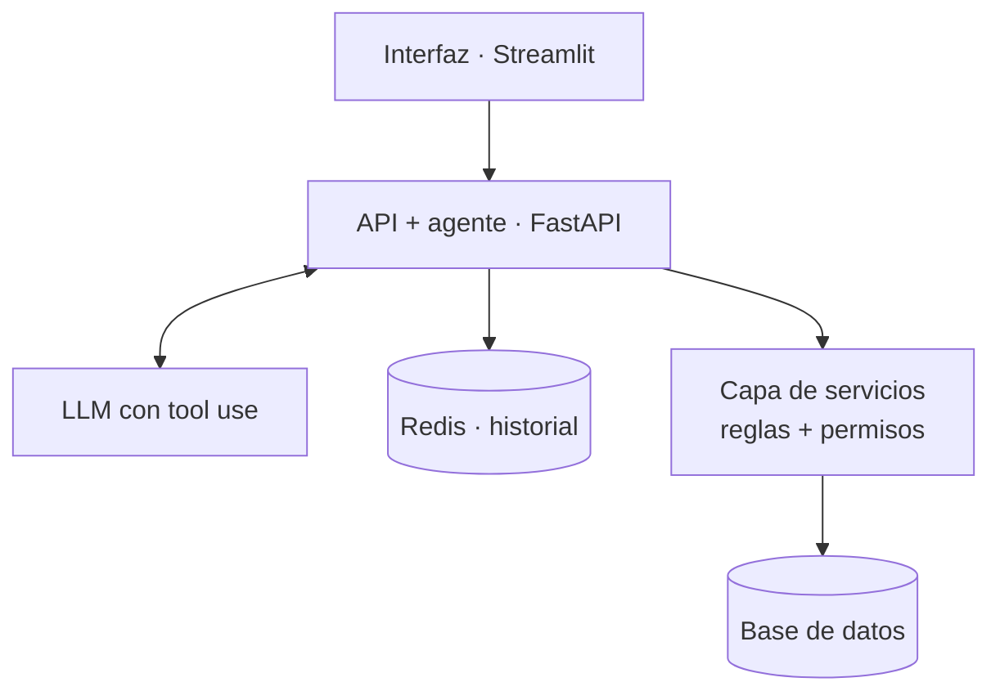

# ShopAgent

Agente de atención al cliente para una tienda online ficticia que no solo responde: **ejecuta acciones reales** (consultar, cancelar pedidos, cambiar direcciones, abrir tickets) mediante *tool use*, con las reglas de negocio blindadas en el backend.

🚧 En desarrollo · semana 1 de 4

## Lo diferencial

1. **El LLM nunca toca la base de datos.** Solo propone qué herramienta usar y con qué argumentos; la capa de servicios valida y ejecuta.
2. **Las reglas de negocio y los permisos viven en el backend, no en el prompt.** Aunque el modelo se equivoque o sufra *prompt injection*, no puede saltárselas.
3. **Las acciones destructivas piden confirmación explícita** del usuario antes de ejecutarse (*human-in-the-loop*).
4. **Un usuario solo ve y modifica sus propios pedidos.** Si pide uno ajeno, se responde "no encontrado", sin revelar que existe.

## Hoja de ruta

- [ ] **Semana 1 — Cimientos sin IA:** modelo de datos, servicios con reglas, API REST, datos de prueba, tests (`v0.1`)
- [ ] **Semana 2 — El agente:** LLM, 5 herramientas, bucle de tool use, confirmación, permisos, Redis, `/chat` (`v0.2`)
- [ ] **Semana 3 — Interfaz y robustez:** Streamlit, manejo de errores, tests del agente con LLM simulado (`v0.3`)
- [ ] **Semana 4 — Producción:** Docker Compose, GitHub Actions, despliegue, *rate limiting*, demo (`v0.4`)

## Arquitectura



## Cómo ejecutarlo

Requisitos: Python 3.14.

```bash
python -m venv .venv
source .venv/Scripts/activate      # Windows (Git Bash) · en Linux/macOS: .venv/bin/activate
pip install -r requirements.txt
cp .env.example .env

uvicorn app.main:app --reload      # docs en http://localhost:8000/docs
pytest
```

## Decisiones de diseño

Se documentan como ADR en [`docs/adr/`](docs/adr/).

## Demo

Próximamente.
