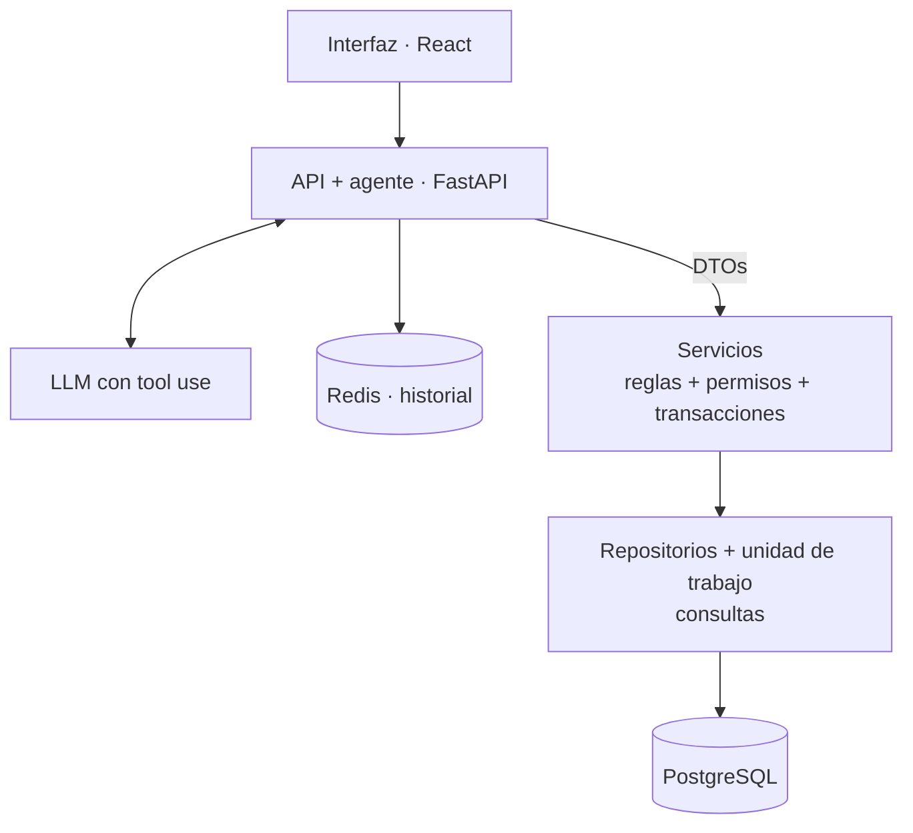

# ShopAgent

Agente de atención al cliente para **Loba Toys**, una tienda online ficticia de juguetes para perros, que no solo responde: **ejecuta acciones reales** (consultar y cancelar pedidos, cambiar direcciones, abrir tickets) mediante *tool use*, con las reglas de negocio blindadas en el backend.

*Última actualización: 22-nov-2026*

## La idea

Los chatbots de atención al cliente suelen quedarse en responder preguntas frecuentes. ShopAgent va un paso más allá: el cliente escribe en lenguaje natural ("cancela mi último pedido", "cambia la dirección del pedido 3") y el agente **actúa** sobre la tienda.

El reto no es que el LLM llame a funciones, sino hacerlo **de forma segura**: un modelo de lenguaje puede equivocarse o ser manipulado, así que nunca se le da poder real. Él propone; el backend decide.

## Lo diferencial

1. **El LLM nunca toca la base de datos.** Solo propone qué herramienta usar y con qué argumentos; la capa de servicios valida y ejecuta.
2. **Las reglas de negocio y los permisos viven en el backend, no en el prompt.** Aunque el modelo se equivoque o sufra *prompt injection*, no puede saltárselas.
3. **Las acciones destructivas piden confirmación explícita** del usuario antes de ejecutarse (*human-in-the-loop*).
4. **Un usuario solo ve y modifica sus propios pedidos.** Si pide uno ajeno, se responde "no encontrado", sin revelar que existe.

## Qué hay hecho

### Tienda (backend)
- Catálogo de 8 juguetes originales con filtro por categoría y control de stock.
- Pedidos con líneas y precio copiado en el momento de la compra (importes en céntimos).
- **Máquina de estados** explícita: `pending → paid → shipped → delivered`, y `cancelled` solo desde `pending` o `paid`.
- ***Checkout*** simulado en una única transacción: descuenta stock con bloqueo de filas y lo repone al cancelar.
- Login con contraseña y **sesión en cookie httpOnly**; registro de nuevos clientes.
- API REST con errores traducidos a HTTP en un único sitio (404 / 409 / 422) y endpoints de demo para avanzar el estado de un pedido.

### Agente
- 5 herramientas: `get_order`, `list_orders`, `cancel_order`, `change_address` y `open_ticket`.
- Bucle de *tool use* sobre una **interfaz de LLM** propia (adaptador para Gemini, intercambiable).
- Argumentos del modelo validados con Pydantic antes de ejecutar nada; si son inválidos, el error vuelve al modelo para que corrija.
- **Confirmación en el backend**: las acciones destructivas quedan pendientes hasta que el usuario las aprueba (`/chat/confirm`).
- Historial de conversación y acciones pendientes en **Redis**, con caducidad.
- Escalado a humano abriendo un ticket cuando no puede resolver algo.

### Interfaz (React)
- Catálogo con filtro por categoría, ficha de producto e indicador de stock.
- Carrito y *checkout*.
- "Mis pedidos" con su estado.
- Chat con el agente en un panel lateral, con botones para confirmar o rechazar acciones; los pedidos se refrescan solos tras una acción confirmada.
- Pantalla de login y registro.
- **Diseño propio:** un sistema visual con variables CSS (papel crema, tinta y rellenos rosa y lima), tarjetas tipo pegatina, fuentes servidas desde el propio proyecto y un bloque de color por categoría como imagen de producto.
- **Accesible:** navegación completa con teclado (tarjetas de producto, modal con Escape y foco retenido), foco visible, contraste AA en el texto, mensajes del chat anunciados a lectores de pantalla y respeto de `prefers-reduced-motion`.
- **Adaptada a móvil:** en pantallas estrechas el chat pasa debajo de la tienda.

### Calidad
- **182 tests** con pytest (servicios, API, autenticación, herramientas y bucle del agente). Los tests usan un LLM falso: no gastan llamadas reales.
- PostgreSQL en todos los entornos (también en los tests) y migraciones con Alembic.

## Arquitectura



**Flujo de una acción destructiva:** el usuario pide "cancela el pedido 5" → el LLM propone `cancel_order(5)` → el backend valida los argumentos y comprueba que el pedido es del usuario → como es destructiva, la guarda como pendiente y pide confirmación → solo si el usuario acepta, el servicio la ejecuta en una transacción.

### Stack

| Capa | Tecnología |
|---|---|
| Backend | Python 3.14, FastAPI, SQLModel, Pydantic |
| Datos | PostgreSQL 17 + Alembic, Redis 7 |
| Agente | Gemini (`gemini-3.5-flash`) tras una interfaz de LLM propia |
| Frontend | React 19 + Vite + TypeScript |
| Tests | pytest, pytest-cov, httpx |
| Entorno | Docker Compose |

### Estructura del repositorio

```
backend/    API + agente (FastAPI), servicios, repositorios, modelos, tests y seed
frontend/   tienda y chat (React + Vite)
docker/     scripts de inicialización de PostgreSQL
docs/       decisiones de diseño (ADR)
```

## Cómo ejecutarlo

Requisitos: Python 3.14, Node 20+ y Docker.

```bash
docker compose up -d db redis      # PostgreSQL 17 en :5433 (shopagentPG y shopagent_test) y Redis 7 en :6380

python -m venv .venv
source .venv/Scripts/activate      # Windows (Git Bash) · en Linux/macOS: .venv/bin/activate

cd backend
pip install -r requirements-dev.txt   # ejecución + tests y lint
cp .env.example .env               # rellena SECRET_KEY y GEMINI_API_KEY (gratis en aistudio.google.com)

alembic upgrade head               # crea/actualiza las tablas con las migraciones
python scripts/seed.py             # BORRA y rellena la BD: 3 clientes (contraseña loba1234), 8 juguetes, 7 pedidos
uvicorn app.main:app --reload      # API en :8000 (docs en /docs; inicia sesión con POST /auth/login)
pytest                             # usa shopagent_test y un LLM falso: no gasta llamadas a Gemini

cd ../frontend
npm install
npm run dev                        # tienda en http://localhost:5173 (entra con lucia@example.com / loba1234)
```

## Decisiones de diseño

Se documentan como ADR (*Architecture Decision Records*) en [`docs/adr/`](docs/adr/):

- [0001 · SQLite en desarrollo, PostgreSQL en producción](docs/adr/0001-sqlite-dev-postgresql-prod.md) *(sustituida por la 0004)*
- [0002 · Capa de servicios como clases con la sesión inyectada](docs/adr/0002-service-layer-as-classes.md)
- [0003 · Frontend en React en lugar de Streamlit](docs/adr/0003-react-frontend.md)
- [0004 · PostgreSQL en todos los entornos y migraciones con Alembic](docs/adr/0004-postgresql-y-alembic.md)
- [0005 · Repositorio genérico, unidad de trabajo y DTOs](docs/adr/0005-repository-unit-of-work-dtos.md)
- [0006 · Diseño del agente: interfaz de LLM, confirmación en el backend e historial en Redis](docs/adr/0006-diseno-del-agente.md)
- [0007 · Login con contraseña y sesión en cookie httpOnly](docs/adr/0007-login-cookie-httponly.md)
- [0008 · Sistema visual con variables CSS y fuentes servidas desde el proyecto](docs/adr/0008-sistema-visual-y-fuentes-propias.md)
