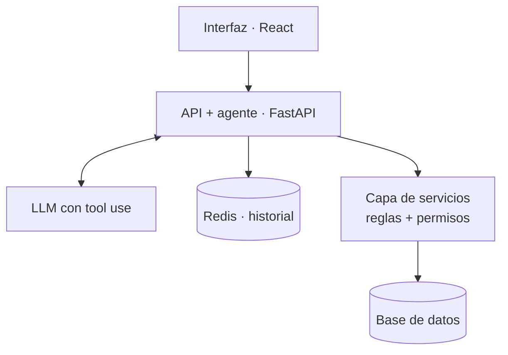

# ShopAgent

Agente de atención al cliente para **Loba Toys**, una tienda online ficticia de juguetes para perros, que no solo responde: **ejecuta acciones reales** (consultar, cancelar pedidos, cambiar direcciones, abrir tickets) mediante *tool use*, con las reglas de negocio blindadas en el backend.

🚧 En desarrollo · fase 1 de 4 · entrega 17-nov

## Lo diferencial

1. **El LLM nunca toca la base de datos.** Solo propone qué herramienta usar y con qué argumentos; la capa de servicios valida y ejecuta.
2. **Las reglas de negocio y los permisos viven en el backend, no en el prompt.** Aunque el modelo se equivoque o sufra *prompt injection*, no puede saltárselas.
3. **Las acciones destructivas piden confirmación explícita** del usuario antes de ejecutarse (*human-in-the-loop*).
4. **Un usuario solo ve y modifica sus propios pedidos.** Si pide uno ajeno, se responde "no encontrado", sin revelar que existe.

## Hoja de ruta

- [ ] **Fase 1 — Cimientos sin IA** (`v0.1`): catálogo y pedidos con líneas, stock, máquina de estados, *checkout* simulado, API REST, datos de prueba, tests
- [ ] **Fase 2 — El agente** (`v0.2`): LLM con 5 herramientas, bucle de tool use, confirmación, permisos, historial en Redis, `/chat`
- [ ] **Fase 3 — La tienda** (`v0.3`): frontend React (catálogo, carrito, pedidos, chat) y visor 3D de los juguetes
- [ ] **Fase 4 — Producción** (`v0.4`): Docker Compose, GitHub Actions, despliegue, *rate limiting*, demo

## Arquitectura



### Estructura del repositorio

```
backend/    API + agente (FastAPI), servicios, modelos, tests y seed
frontend/   tienda y chat (React + Vite) · fase 3
docs/       devlog y decisiones de diseño (ADR)
```

## Cómo ejecutarlo

Requisitos: Python 3.14.

```bash
python -m venv .venv
source .venv/Scripts/activate      # Windows (Git Bash) · en Linux/macOS: .venv/bin/activate

cd backend
pip install -r requirements.txt
cp .env.example .env

uvicorn app.main:app --reload      # docs en http://localhost:8000/docs
pytest
```

## Decisiones de diseño

Se documentan como ADR (*Architecture Decision Records*) en [`docs/adr/`](docs/adr/):

- [0001 · SQLite en desarrollo, PostgreSQL en producción](docs/adr/0001-sqlite-dev-postgresql-prod.md)
- [0002 · Capa de servicios como clases con la sesión inyectada](docs/adr/0002-service-layer-as-classes.md)
- [0003 · Frontend en React en lugar de Streamlit](docs/adr/0003-react-frontend.md)

## Demo

Próximamente.
